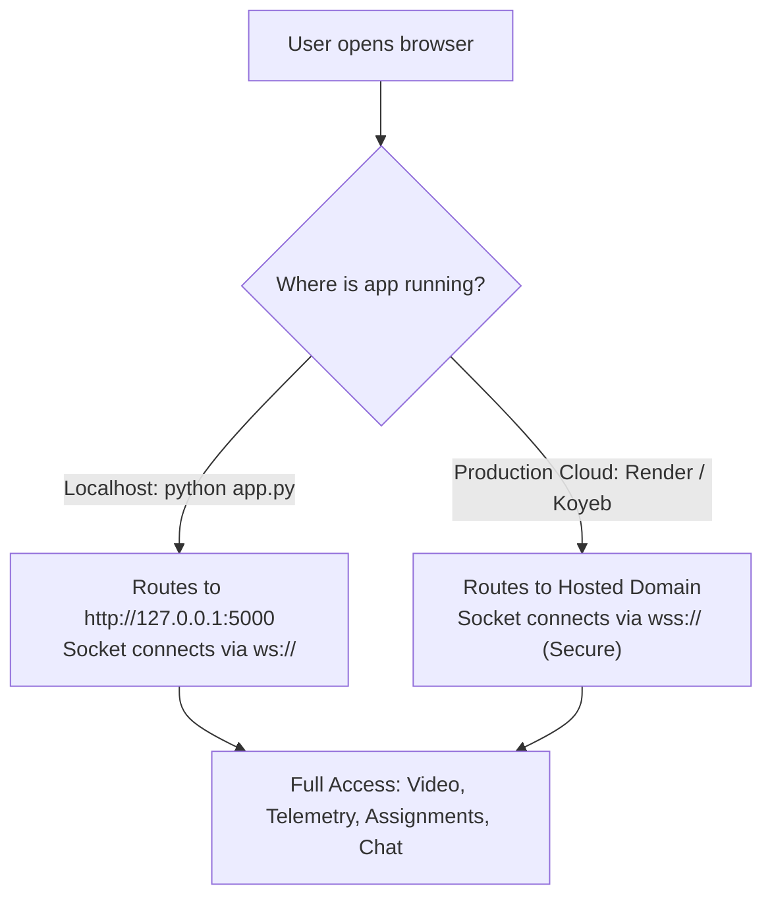

# 🌐 How to Host EduMonitor 100% Free Forever

This guide provides step-by-step instructions to deploy **EduMonitor** to production on the cloud for **$0 / free forever**, with full support for:
- ⚡ **WebSockets** (real-time chat, hand-raising, live polls, quizzes, and telemetry)
- 🔒 **Automatic SSL / HTTPS** (required by browsers for webcam & microphone permissions)
- 🔄 **Continuous Deployment** (pushes to your GitHub repository automatically redeploy)
- 💻 **Dual Compatibility** (runs identically on both `localhost:5000` and your hosted production URL)

---

## 🏆 Recommended Platform: Render.com (100% Free Tier)

**Render** provides a completely free tier with **750 free instance hours per month** (sufficient to keep your application live 24/7 every month), native WebSocket support, and automated GitHub continuous deployment.

### Step 1: Create a Free Account on Render
1. Visit **[https://render.com](https://render.com)**.
2. Click **"Get Started"** or **"Sign In"** and choose **"Sign in with GitHub"** (log in with your GitHub account: `Akshay4251`).

---

### Step 2: Create a New Web Service
1. In your Render Dashboard, click the blue **"New +"** button at the top right.
2. Select **"Web Service"**.
3. Under *Connect a repository*, choose your repository:
   👉 **`EduMonitor-Student-Monitoring-System`**
   *(If you don't see it, click "Configure GitHub App" to give Render access to your repository).*
4. Click **"Connect"**.

---

### Step 3: Configure Service Settings
Render will auto-detect settings from the repository's [`render.yaml`](render.yaml) and [`Procfile`](Procfile). Verify the following fields:

| Field | Setting |
| :--- | :--- |
| **Name** | `edumonitor` *(or any custom name you prefer)* |
| **Region** | Choose closest to you (e.g. *Singapore*, *Frankfurt*, *Oregon*) |
| **Branch** | `main` |
| **Root Directory** | *(Leave blank / default)* |
| **Runtime** | `Python 3` |
| **Build Command** | `pip install -r requirements.txt` |
| **Start Command** | `gunicorn --worker-class eventlet -w 1 --bind 0.0.0.0:$PORT app:app` |
| **Instance Type** | **Free** ($0 / month) |

---

### Step 4: Environment Variables (Optional)
Under the **Environment Variables** section on Render, you can optionally configure:

1. `SECRET_KEY`: Set to any long random string (e.g. `edumonitor-production-secret-key-2026`).
2. `PYTHON_VERSION`: `3.11.9` *(recommended for high compatibility)*.
3. **If using Google Cloud Firebase**:
   Add the variables from your `.env.example`:
   - `FIREBASE_PROJECT_ID`: `your-firebase-project-id`
   - `FIREBASE_API_KEY`: `AIzaSy...your-web-api-key`
   - `FIREBASE_AUTH_DOMAIN`: `your-firebase-project-id.firebaseapp.com`
   - `FIREBASE_SERVICE_ACCOUNT_JSON`: Paste the raw JSON text of your service account key file.

*(Note: If you leave Firebase variables unset, EduMonitor immediately runs in **Zero-Setup Institutional Database Mode**, using its pre-seeded 5 university courses, faculty members, scholars, assignments, and sessions with disk persistence).*

---

### Step 5: Deploy
1. Click **"Create Web Service"**.
2. Render will automatically pull the code from GitHub, install dependencies, and boot the Gunicorn Eventlet server.
3. In **2 to 3 minutes**, your status will turn to **`Live`** 🟢!
4. Your free public URL will be displayed at the top:
   👉 **`https://edumonitor.onrender.com`** *(or your chosen name)*.

---

## ⚡ Alternative Free Platform: Koyeb (No-Sleep Free Tier)

If you prefer a platform that never spins down when inactive:
1. Visit **[https://www.koyeb.com](https://www.koyeb.com)** and sign in with GitHub.
2. Click **"Create App"** -> **"GitHub"**.
3. Select `EduMonitor-Student-Monitoring-System`.
4. Choose **"Buildpack"** or specify:
   - Build Command: `pip install -r requirements.txt`
   - Run Command: `gunicorn --worker-class eventlet -w 1 --bind 0.0.0.0:8000 app:app`
5. Select the **Eco Free Instance** ($0/month).
6. Click **"Deploy"**. Your live URL (e.g. `https://edumonitor-yourname.koyeb.app`) will be active within minutes.

---

## 🔄 Dual Compatibility: How It Works on Both Hosted & Localhost

EduMonitor includes automatic origin detection in both [`static/js/firebase-init.js`](static/js/firebase-init.js) and [`static/js/socket-client.js`](static/js/socket-client.js):

1. **Local Development**:
   - Run `python app.py`.
   - Access `http://localhost:5000`.
   - WebSockets connect to `ws://localhost:5000`.
2. **Hosted Cloud Production**:
   - Access `https://your-app.onrender.com`.
   - WebSockets connect securely via `wss://your-app.onrender.com`.
   - The browser recognizes `https://` as secure context and grants permission for WebRTC video, microphone, and screen sharing.

---

## 💡 Keeping Render Free Service Active (Optional Tip)
On Render's free tier, free instances spin down after 15 minutes of no web traffic, and wake up in ~30 seconds when someone visits.
If you want your app to respond instantly 24/7 without the wake-up delay:
1. Go to **[cron-job.org](https://cron-job.org)** or **[uptimerobot.com](https://uptimerobot.com)** (both 100% free forever).
2. Create an HTTP monitor that pings `https://your-app.onrender.com/api/config/firebase` every **10 minutes**.
3. This keeps your free Render service permanently awake 24/7!
